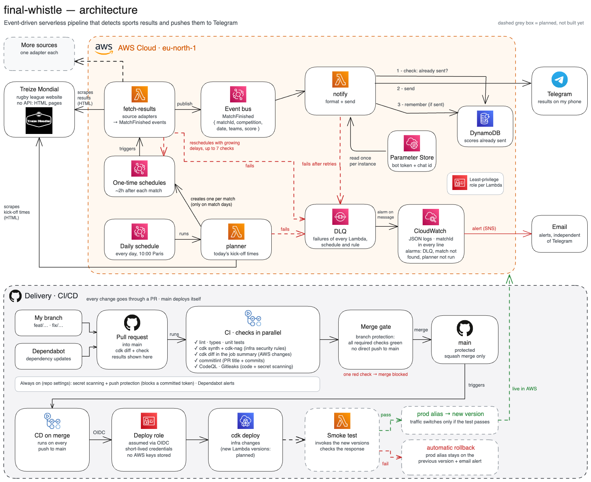

# final-whistle

Event-driven serverless pipeline on AWS that detects sports results and pushes them to Telegram.
Designed to be deployed with AWS CDK and GitHub Actions (OIDC), observable end to end, and €0 to run.

## Why

Popular live-score apps cover the big leagues, but not amateur teams or lesser-known sports. Their results are published late, on scattered websites, and I ended up checking them by hand. I wanted each score on my phone shortly after the final whistle.

Rugby league comes first, from the lowest amateur division up to the professional level. Other sports may follow later, each through its own source adapter.

It is also a side project to practise serverless and event-driven design on a real use case, where the interesting questions are what happens when a step fails, when the same event arrives twice, or when a deployment goes wrong.

## How it works

1. **Every morning**, a schedule runs the `planner` Lambda. It reads the day's kick-off times on [Treize Mondial](https://treizemondial.fr/matchs-du-jour-rugby-a-xiii/).
2. For each match, the planner creates a **one-time schedule** about 2 hours after kick-off, never at night (23:00 to 08:00). No match, nothing is scheduled.
3. When a schedule fires, `fetch-results` reads the result through a **source adapter** and publishes a `MatchFinished` event on an EventBridge bus. If the score is not published yet, it schedules its next check itself, waiting longer each time (1 h, 1 h, 1 h, 2 h, 4 h, then 8 h, never at night), and gives the match up after 7 checks.
4. `notify` is subscribed to `MatchFinished`. For each event it:
   1. **checks** in DynamoDB that the score was not already sent,
   2. **sends** it to Telegram,
   3. **remembers** it in DynamoDB, only once the message has gone out.

The bot token and the chat id live in SSM Parameter Store and are read once per Lambda instance.

## Reliability

- **At-least-once delivery**: send, then record. If `notify` crashes between the two steps, the score goes out twice rather than never.
- **Idempotence**: the DynamoDB check absorbs the duplicates caused by retries.
- **Dead-letter queue**: an event that still fails after Lambda's retries, or that a schedule or the bus cannot deliver, lands in an SQS queue instead of disappearing.
- **Alerting**: CloudWatch alarms (a message in the DLQ, a match never found on the page, a planner that stopped running) email me through SNS, a channel that keeps working when Telegram does not.
- **Traceability**: structured JSON logs carrying the match id, so one match can be followed across all Lambdas.
- **Least privilege**: one IAM role per Lambda, limited to what it actually uses.

## Delivery

Every change goes through a pull request; `main` is protected and deploys itself.

- **CI on each pull request**: lint, types, unit tests, `cdk synth` with [cdk-nag](https://github.com/cdklabs/cdk-nag) security rules, `cdk diff` in the job summary, commitlint, CodeQL and Gitleaks.
- **Merge gate**: all required checks green, squash merge only, no direct push to `main`.
- **CD on merge**: each merge deploys to the GitHub `production` environment, which only `main` can use. GitHub Actions assumes an AWS role through OIDC (no AWS keys stored), runs `cdk deploy`, then a smoke test on the new Lambda versions. The `prod` alias moves to the new version only if the test passes; otherwise it stays on the previous one and I get an alert.
- **Always on**: secret scanning with push protection, Dependabot alerts and updates.

## Cost

€0 in practice: the services used stay within the AWS Always Free quotas (Lambda, EventBridge Scheduler, DynamoDB in provisioned mode, SQS, SNS, CloudWatch), apart from a few custom events and the CDK assets bucket, which cost fractions of a cent.

## Stack

TypeScript · AWS Lambda (Node.js, arm64) · EventBridge (Scheduler and event bus) · DynamoDB · SQS · SNS · SSM Parameter Store · CloudWatch · AWS CDK · GitHub Actions

## Status

Work in progress: the diagram shows the target architecture, built one step at a time; its dashed grey boxes are not built yet.

- Done: TypeScript project, required pull request checks (lint, types, unit tests, commitlint, Gitleaks, CodeQL), Dependabot updates, an empty CDK app synthesized on each pull request with cdk-nag rules, GitHub OIDC roles, a `cdk diff` of each pull request and a `cdk deploy` on each merge to `main`.
- Done: the Treize Mondial adapter, the event bus and the `fetch-results` Lambda, which publishes `MatchFinished` once a match is finished.
- Done: the `notify` Lambda, subscribed to `MatchFinished`: it checks DynamoDB, sends the score to Telegram, then records it.
- Done: the `planner` Lambda, run every day at 10:00 (Paris time): it schedules one `fetch-results` check per match, about 2 hours after kick-off and never at night. When the score is not published yet, `fetch-results` checks again later, with growing delays, up to 7 checks.
- Done: the dead-letter queue, fed by every Lambda and every schedule or rule that invokes one, and three CloudWatch alarms that email me through SNS.
- Next: the smoke test and the `prod` alias rollback.

Progress is tracked in the [v1 milestone](https://github.com/TomSoulage/final-whistle/milestone/1).

## Design decisions

Each structural choice and its trade-offs are recorded in [docs/decisions.md](docs/decisions.md).

## License

[MIT](LICENSE)
